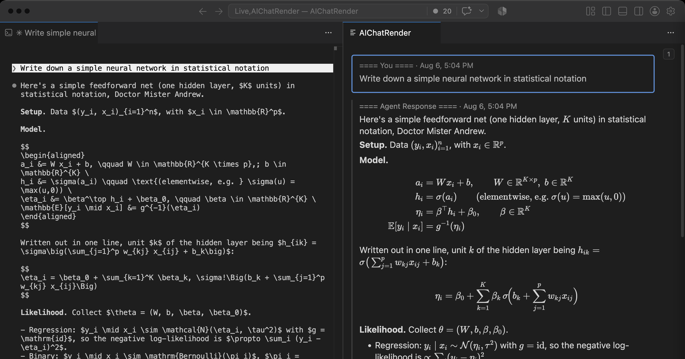
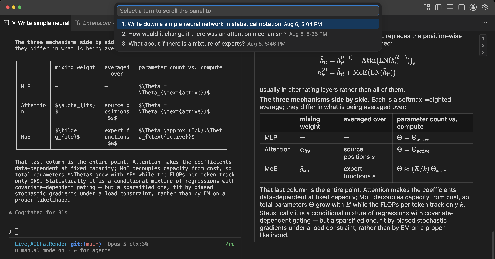

# AIChatRender

Read your Claude Code or Codex CLI session in a VS Code panel, with the math
nicely rendered. Scroll back, browse turns, while you compose your next response. `Cmd+c` in the rendered panel, then `Cmd+v` pastes the Markdown translation.

> **Unaffiliated.** AIChatRender is an independent tool. It is not made,
> endorsed, or supported by Anthropic or OpenAI. It reads the session files
> those CLIs already write to your own disk; it uses no API and no account.

## Browser viewer

This repository also holds **chatview**, a browser version of the same
renderer that needs no VS Code. It serves the local Claude Code and Codex
sessions over HTTP; pick a session in the page and it follows it live. See
[chatview/README.md](chatview/README.md). New work happens there; the VS Code
extension is maintenance-only.

## Requirements

- **Claude Code or Codex CLI**, run from this workspace. AIChatRender reads the
  session files they already write; there is nothing to configure in either.
- **VS Code 1.85 or newer.**
- **Linux or macOS.** Following the active terminal needs process introspection:
  `/proc` on Linux, `pgrep`/`lsof`/`ps` on macOS. On Windows, use WSL or a
  remote/container workspace — AIChatRender declares
  `"extensionKind": ["workspace"]`, so it runs on the Linux side of a remote
  window. Run natively on Windows, the panel and manual transcript picking still
  work, but **Follow Active Terminal Chat** reports that it is unsupported
  rather than silently failing.

## Commands

| Command | What it does |
| --- | --- |
| `AIChatRender: Show Panel` | Open the panel, following the newest transcript. |
| `AIChatRender: Follow Active Terminal Chat` | Pin to the active terminal's chat. |
| `AIChatRender: Browse Turns and Pick` | List the chat's user prompts and scroll to one. |
| `AIChatRender: Search Chat Source` | Search the Markdown and LaTeX behind the rendering. `Cmd+Shift+F` / `Ctrl+Shift+F` with the panel focused. |

`Cmd+F` (`Ctrl+F`) with the panel focused opens VS Code's find widget over the
rendered chat. It searches the text as displayed, which is why **Search Chat
Source** exists: the panel draws `\theta` as θ, so only a search of the source
can match `\theta`.

## What it does

- **Renders math** with a vendored, pinned KaTeX: `$$…$$` and `\[…\]` display,
  `\(…\)` and `$…$` inline, with Pandoc-style guards so currency and `$VAR`
  don't trigger false positives.
- **Renders a small Markdown subset** — headings, lists, blockquotes, rules,
  emphasis, code, and tables with alignment and math inside cells. Raw HTML and
  links stay inert text, deliberately.
- **Copies back out as Markdown source.** Equations become their original
  LaTeX; tables keep their pipe syntax and alignment.
- **Shows tool calls** in the terminal's visual language: the tool and its
  argument, the first lines of its result, and a count of what was left unread.
  File edits report added and removed line counts and draw the diff in the
  editor's own diff colours.
- **Shows the newest 100 user turns** of assistant text and real prompts.
  Thinking blocks, subagent traffic, and harness bookkeeping are skipped.

Each of these is covered in full in [`docs/reference.md`](docs/reference.md).

## How it works

AIChatRender watches the session files the two CLIs already write to your disk:
Claude transcripts under `~/.claude/projects/`, Codex rollouts under
`~/.codex/sessions/`. It follows whichever was written most recently and
switches automatically.

A session counts as this workspace's when its cwd is the workspace folder or any
directory beneath it, so a CLI started in a subfolder is still followed.
**Follow Active Terminal Chat** goes further and pins the panel to the
transcript held open by your active terminal's process tree; when that terminal
can't be matched — an idle CLI often closes its transcript — a picker lists the
workspace's recent chats instead.

Nothing is installed into either agent. There are no hooks, no configuration
changes, and no second copy of your history.

## Security and privacy

This is an extension that reads your AI chat transcripts, so the scope is worth
stating precisely.

- **Read-only.** It never writes under `~/.claude/` or `~/.codex/`, and keeps no
  copy, inbox, or history of its own.
- **No network, and no local server.** No HTTP listener, socket, port, or CDN
  request. A loopback server would be reachable by other processes on the
  machine; there isn't one. KaTeX is vendored and served over VS Code's internal
  webview channel.
- **No agent hooks.** Neither CLI's configuration is modified.
- **Nothing from a transcript is executed or made clickable.** Raw HTML and
  links stay inert, tool output is inserted as plain text rather than parsed,
  and Codex wrapper programs are statically analyzed but never run.
- **Codex discovery reads the first line of rollouts from your other projects**
  to find the one belonging to this workspace. Only `cwd` and a timestamp are
  retained; nothing from a nonmatching rollout is logged or reaches the webview.
- **Transcripts are sensitive files.** A session can hold prompts, command
  output, diffs, paths, and any secret that ever appeared in them. AIChatRender
  keeps no extra copy, but it does put that content on screen — worth
  remembering when sharing a screen or recording.

These choices reduce the extension's attack surface. They do not sandbox the
underlying agent or make the panel a tamper-proof audit log. The reasoning
behind each is in [`docs/reference.md`](docs/reference.md).

## Known limitations

- **Copying an equation currently brings extra text with it.** The original
  LaTeX is there and correct, but it arrives wrapped in two other renderings of
  the same formula, so a pasted `$$…$$` block needs the surrounding text
  trimmed by hand. Prose, lists, code, and tables copy cleanly; this affects
  math only.
- Exactly one workspace folder.
- With concurrent Claude and Codex sessions, the panel follows whichever
  matching file changed last unless you pin one.
- Codex discovery scans only the last seven date directories, so an older
  rollout is not followed even when resumed.
- These CLIs ship frequently and their session formats are internal and
  undocumented. A format change can break parsing until it's fixed; parsing is
  fail-soft, so an unfamiliar record leaves prose intact and raises the panel's
  format-drift notice.

The full list, including Codex code-mode and macOS PID-reuse caveats, is in
[`docs/reference.md`](docs/reference.md).

## License and citation

MIT — see `LICENSE`. Use it freely, including in commercial work. Bundled KaTeX
is separately MIT-licensed; see `media/katex/LICENSE`.

If AIChatRender is useful in academic work, a citation is appreciated but not
required by the license:

> Chen, Andrew Y. (2026). *AIChatRender: rendered math for AI coding-agent
> transcripts in VS Code.*
